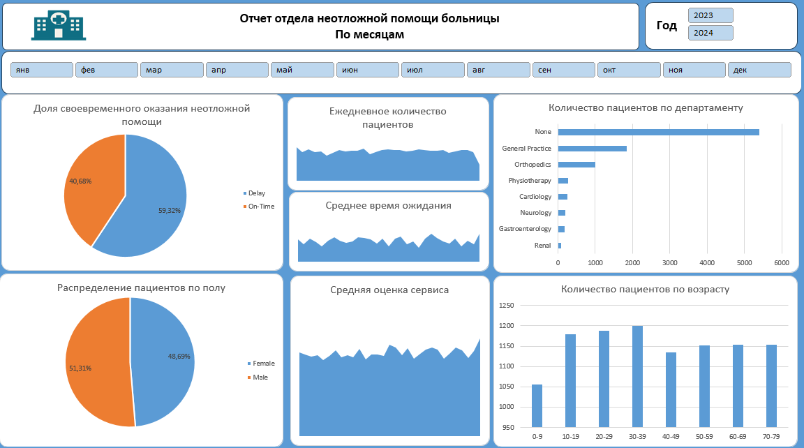

# 🏥 Hospital ER Dashboard

Интерактивный дашборд в Excel для анализа работы отделения неотложной помощи (ER) больницы: нагрузка, время ожидания, удовлетворённость пациентов и распределение обращений по отделениям.



## 📌 О проекте

Проект отвечает на практические вопросы руководства отделения:

- Сколько пациентов поступает ежедневно и как меняется нагрузка по месяцам?
- Как долго пациенты ждут помощи и как часто помощь оказывается вовремя?
- Насколько пациенты довольны сервисом?
- Какие отделения и возрастные группы создают основную нагрузку?

## 📊 Данные

| Параметр | Значение |
|---|---|
| Период | 01.04.2023 – 30.10.2024 |
| Количество обращений | 9 216 уникальных пациентов |

**Поля:**

| Поле | Описание |
|---|---|
| `Patient Id` | Идентификатор пациента (`###-##-####`) |
| `Patient Admission Date` | Дата обращения (`DD-MM-YYYY HH:MM`)|
| `Patient First Inital` | Первый инициал пациента |
| `Patient Last Name` | Фамилия пациента |
| `Patient Gender` | Пол |
| `Patient Age` | Возраст |
| `Patient Race` | Расовая / этническая принадлежность |
| `Department Referral` | Отделение, в которое направлен пациент (`None` — без направления) |
| `Patient Admission Flag` | Госпитализирован / не госпитализирован (`TRUE`/`FALSE`)|
| `Patient Satisfaction Score` | Оценка сервиса от 0 до 10 (заполнена не у всех пациентов) |
| `Patient Waittime` | Время ожидания, мин |

> ⚠️ Данные учебные/обезличенные. Не загружайте в репозиторий реальные персональные данные пациентов.

## 🧰 Инструменты

- **Microsoft Excel**: сводные таблицы и сводные диаграммы, срезы
- **Power Query**: загрузка и очистка данных, календарная таблица `Calendar_Table`
- **Power Pivot**: связь таблицы фактов с календарём

## 🗂 Структура репозитория

```
Hospital-Dashboard/
├── data/              # исходные данные
├── Dashboard.xlsx     # итоговая книга с анализом и дашбордом
└── README.md
```

**Листы в `Dashboard.xlsx`:**

| Лист | Содержание |
|---|---|
| `Cleaned_Data` | Очищенный набор данных (таблица `My_Hospital_ER_Data`) |
| `EDA` | Сводные таблицы для разведочного анализа |
| `Detailed Reports` | Детальные отчёты по месяцам (диаграммы) |
| `Dashboard` | Итоговый дашборд «Отчёт отдела неотложной помощи больницы» |

## 📈 Ключевые показатели

| Метрика | Значение |
|---|---|
| Всего пациентов | 9 216 |
| Среднее время ожидания | ≈ 35,3 мин |
| Средняя оценка сервиса | ≈ 4,99 из 10 |
| Доля обращений с задержкой / вовремя | 59,3 % / 40,7 % |
| Госпитализированы / не госпитализированы | 50,0 % / 50,0 % |
| Мужчины / женщины | 51,3 % / 48,7 % |

**Что показывает дашборд:**

- **Ежедневное количество пациентов**: динамика нагрузки;
- **Среднее время ожидания** по месяцам;
- **Средняя оценка сервиса** по месяцам;
- **Доля своевременного оказания помощи** (Delay / On-Time);
- **Распределение пациентов по полу**;
- **Количество пациентов по возрасту** (группы по 10 лет);
- **Количество пациентов по отделениям**.

Фильтрация выполняется срезами по **году** и **месяцу**, все графики обновляются синхронно.

## 🔍 Основные наблюдения

- Больше половины обращений (около 59 %) обрабатываются с задержкой.
- Возрастные группы представлены примерно поровну (≈ 1 050–1 200 пациентов в каждой).
- Большинство пациентов (5 400) пришли без направления в профильное отделение; среди направленных лидируют *General Practice* (1 840) и *Orthopedics* (995).
- Оценка сервиса указана лишь примерно у четверти пациентов (2 517 из 9 216), поэтому выводы по удовлетворённости нужно делать с осторожностью.

## 🛣 Возможные улучшения

- Добавить анализ загрузки по часам и дням недели
- Сравнить время ожидания по отделениям и возрастным группам
- Портировать дашборд в Power BI / Tableau
